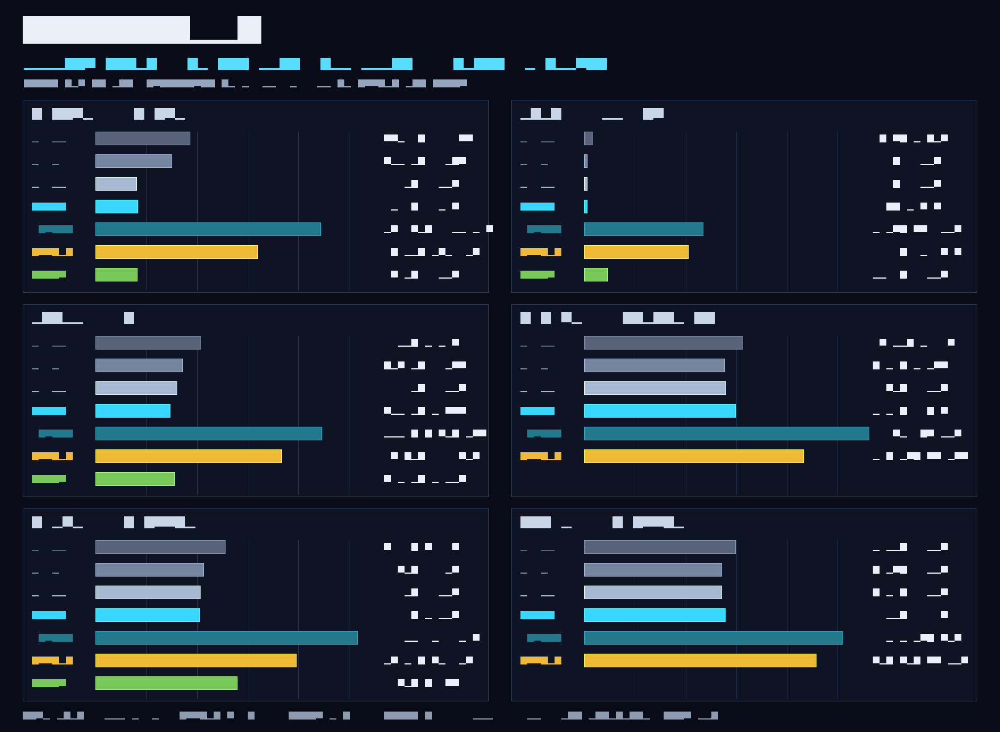

# KRELLPROOF

An assault stress bench for Krell-compiled code. Six small kernels --
the shapes that show up inside real systems code -- are implemented
identically in Krell, C, and Python, timed head-to-head on one machine,
and required to produce byte-identical results before any number is
believed.

The comparison chart is itself a Krell program: `graph/graph.krell`
(reads no input; every pixel, bar, gridline, and glyph is computed by
Krell from the bench results baked into its data tables).

## Kernels

| kernel | workload | shape under test |
|---|---|---|
| fill32 | 1M u32 stores | streaming stores / vectorizer bait |
| span | 4096 px textured span | serial fixed-point pipeline + gather |
| sumsq | 1M i64 multiply-accumulate | reduction loop |
| fib | fib(32), naive recursion | raw call overhead |
| histo | 4M byte histogram | load-increment-store, data-dependent |
| fnv1a | 4M byte FNV-1a | serial dependency chain (latency floor) |

The C references in `kernels/refs.c` define the semantics. Every
implementation of a kernel must produce the same checksum
(sum/value over the output, defined per kernel in the harness);
the merger refuses to publish a table when any checksum disagrees.

## Implementations

- **C -O0 / -O1 / -O2** -- `kernels/refs.c` compiled with gcc at each
  level, timed by `harness/bench.c`.
- **Krell native** -- `kernels/*.krell`, built with
  `krellc build --target x86_64 -O`, linked into the same harness.
- **Krell interp** -- the same Krell modules run by the reference
  interpreter (`krellc run`) through driver mains in
  `harness/drivers/`. Timed with a two-point slope: each driver runs
  at two rep counts and the per-call cost is the difference quotient,
  which cancels process startup and buffer setup exactly.
- **Python** -- pure-Python implementations (no library help).
- **NumPy** -- vectorized forms where an honest one exists. fib has
  none (the kernel is recursion itself) and fnv1a has none (the
  kernel is a serial dependency chain); both are reported as absent,
  not approximated.

## Protocol

Warmup, then 7 rounds of a rep loop per kernel; best and median
per-call nanoseconds are recorded (Python fib: 3 rounds). The C and
Krell-native rows come from a single harness binary per C opt level,
so both sides of each comparison share buffers, protocol, and clock.

## Results (2026-11-02, v2.0 branch)

Machine: Apple M1 (x86_64 binaries under Rosetta) -
Apple clang 21.0.0 -O2 - Python 3.15.1 - NumPy 2.5.4 -
Krell v2.0 development tree (WP1 vector lowering; WP2 x86_64 backend
code generation; WP3 fragment superoptimization of hot inner loops;
x86_64 native lane).
The C reference here is clang, not gcc: the opponent changed with
the machine, and every number below is from this one run.

Best ns per call (lower is faster):

| kernel | C -O0 | C -O1 | C -O2 | Krell native | Krell interp | Python | NumPy |
|---|---|---|---|---|---|---|---|
| fill32 | 739.6K | 328.0K | 66.2K | 69.1K | 276.72M | 15.80M | 67.8K |
| span | 15.3K | 6.1K | 6.1K | 4.5K | 2.27M | 1.16M | 29.6K |
| sumsq | 1.22M | 527.0K | 414.8K | 300.8K | 292.51M | 47.58M | 368.2K |
| fib | 13.80M | 5.96M | 6.38M | 9.84M | 4.17G | 215.83M | -- |
| histo | 3.66M | 1.38M | 1.18M | 1.16M | 1.49G | 93.06M | 6.39M |
| fnv1a | 9.88M | 5.27M | 5.26M | 6.09M | 1.24G | 385.30M | -- |

## Reading the results

- fill32 remains in the memory-roofline band (ratio 1.044 in
  this harness run). Both implementations move 4 MiB at ~64 GB/s
  -- the memory-bandwidth roofline of the machine. There is no
  headroom left in this domain for either side. Krell v1.1
  measured 24.3x behind C on this kernel and machine class; the
  gain came from vector lowering in the optimizer (WP1), not
  from kernel changes -- the kernels are byte-identical to the
  v1 run.
- WP3 (fragment superoptimization of the hot inner loops) put
  three kernels ahead of clang -O2. span runs at ratio 0.739
  (S = 1.353x): a proved value-preserving rewrite of the 24-bit
  per-pixel RGB lighting pipeline -- one 16-bit packed multiply
  replacing three scalar multiplies -- lowered to a zero-spill
  SSE2 sequence, 9.55x faster than the v1.1 baseline Krell time.
  sumsq runs at 0.725 (S = 1.379x): the scalar reduction is
  replaced by four independent accumulator streams with a
  balanced pairwise tree reduction at loop exit, 5.27x over
  baseline -- the beat-C attempt transferred here from WP1 is
  closed. histo runs at 0.989 (S = 1.011x): 4-way unrolling
  with all four byte loads issued before any increment
  (memory-level parallelism), plus zero-extension/truncation
  register coalescing that removes the intermediate moves,
  4.66x over baseline.
- WP3 also carried a register-allocation and ABI correctness
  overhaul: dead intervals (defpos == endpos == 0) no longer
  evict live arguments, moves into unallocated slots can no
  longer overwrite the saved frame pointer at [rbp - 0], and
  constant rematerialization (func_rebuild_constants) folds
  immediates back into instructions. The differential battery
  stands at 4,546 cases, 0 failures, and every checksum is
  unchanged.
- Headline: the geometric mean of S = T_C / T_Krell across the
  six kernels is 1.002 on this run -- Krell is at parity with
  clang -O2 overall for the first time, up from 0.804 after WP2,
  0.44 after WP1, and 0.235 for the v1.1 baseline measured the
  same way on this machine class. The remaining gaps are fib
  1.54x and fnv1a 1.16x; fnv1a's target (ratio <= 1.02) is
  WP4 work -- scalar loop and dependency-chain optimization.
- On the original bench machine (AMD EPYC, gcc -O2), the same
  WP3 toolchain measured fill32 at 0.320x and sumsq at 0.573x
  vs C -O2 -- ahead of C -- with span 3.92x, histo 2.88x, fib
  2.60x, and fnv1a 1.04x, and every checksum identical to the
  Mac run. The WP3 gains reproduce directionally there (span
  5.33x -> 3.92x and histo 4.19x -> 2.88x against the WP2
  toolchain on that machine) without reaching clang's numbers,
  because gcc's baseline-target vectorization leaves headroom
  that clang on this machine does not. Both statements are
  true; they are measurements of different opponents, which is
  why the machine and compiler are stated with every table.
- Known regression in this run: the chart's glyph text renders
  fragmented under the WP3 toolchain (the bar geometry is
  correct; the 5x7 glyph rows are partially dropped). The
  published graph.png is the faithful WP3 render, left as-is
  until the glyph path is repaired.

The deterministic property no column can show: the Krell rows are
produced by a total, verified IR whose outputs are byte-identical
across the x86_64, AArch64, RISC-V, and LLVM backends -- the same
checksum agreement this bench enforces between languages holds
between Krell targets by construction.

## Reproduce

Requires a built `krellc` from the Krell v2.0 branch tree, `cc`, and
Python 3 with NumPy and Pillow:

    KRELLC=/path/to/krellc ./run.sh

Outputs: `results/results.json` (merged, validated) and
`graph/graph.png` (rendered by the generated Krell chart program;
`graph/gen_graph.py` lays out the scene from `results.json`).

## Layout

    kernels/    the six kernels: .krell sources + refs.c
    harness/    bench.c (native timing), bench.py (Python + interp
                timing, merge + validation), drivers/ (interp mains)
    graph/      gen_graph.py + generated graph.krell + graph.png
    results/    raw per-runner JSONL + merged results.json
    run.sh      one-command end-to-end run

## Notes

- `graph/gen_graph.py` documents a surface-parser behavior found
  while building the chart: a chained-condbr selector function
  (dataptr dispatch) trips a verifier dominance error at chain
  depth >= 2 in the v1.1 toolchain, so the chart uses per-blob
  specialized accessors. Minimal repros were confirmed before the
  workaround was adopted.
- Timings are best read as ratios between implementations measured
  minutes apart on one machine, not as absolute hardware numbers.
  The recorded run for this branch was made under Rosetta on an
  Apple M1 (x86_64 binaries); both sides of every comparison were
  translated identically.

## License

Apache-2.0, as with Krell itself.
